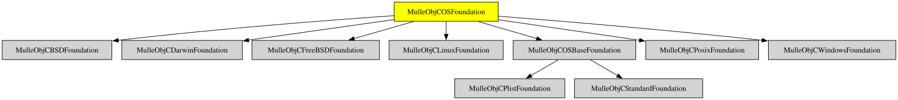

# MulleObjCOSFoundation

#### 💻 Platform-dependent classes and categories like NSTask, NSPipe

These classes build on **MulleObjCStandardFoundation** and provide OS-specific
functionality. This library also adds categories on NSString to deal with
the native C String encoding of the platform.

It builds differently on each platform.

> Note: a few tests may fail because of missing implementations.
>
> Ideally - maybe - this library should move all the OS-specifica into C
> libraries and then cease to exist.


| Release Version                                       | Release Notes  | AI Documentation
|-------------------------------------------------------|----------------|---------------
|  [](//github.com/MulleFoundation/MulleObjCOSFoundation/actions) | [RELEASENOTES](RELEASENOTES.md) | [DeepWiki for MulleObjCOSFoundation](https://deepwiki.com/MulleFoundation/MulleObjCOSFoundation)


## API

### Classes

| Class                   | Description
|-------------------------|----------------------------------------
| `NSBundle`              | Plugins and dynamic loading
| `NSDirectoryEnumerator` | List folder contents of the filesystem
| `NSFileHandle`          | Wrapper for file descriptors (open)
| `NSFilemanager`         | Filesystem management, like file deletion
| `NSPipe`                | Support for inter-process pipes
| `NSProcessInfo`         | Access to the environment and arguments
| `NSRunLoop`             | A wrapper around `select()` usually
| `NSTask`                | Does vfork() and execvs() on Unix
| `NSUserDefaults`        | Access to the program settings (registry)


## Documentation & Guides

* [API Summary](asset/dox/api/toc)


## Requirements

|   Requirement         | Release Version  | Description
|-----------------------|------------------|---------------
| [MulleObjCOSBaseFoundation](https://github.com/MulleFoundation/MulleObjCOSBaseFoundation) |  [](https://github.com/MulleFoundation/MulleObjCOSBaseFoundation/actions/workflows/mulle-sde-ci.yml) | 
| [MulleObjCPosixFoundation](https://github.com/MulleFoundation/MulleObjCPosixFoundation) |  [](https://github.com/MulleFoundation/MulleObjCPosixFoundation/actions/workflows/mulle-sde-ci.yml) | This is a [mulle-sde](https://mulle-sde.github.io/) project.
| [MulleObjCBSDFoundation](https://github.com/MulleFoundation/MulleObjCBSDFoundation) |  [](https://github.com/MulleFoundation/MulleObjCBSDFoundation/actions/workflows/mulle-sde-ci.yml) | This is a [mulle-sde](https://mulle-sde.github.io/) project.
| [MulleObjCFreeBSDFoundation](https://github.com/MulleFoundation/MulleObjCFreeBSDFoundation) |  [](https://github.com/MulleFoundation/MulleObjCFreeBSDFoundation/actions/workflows/mulle-sde-ci.yml) | This is a [mulle-sde](https://mulle-sde.github.io/) project.
| [MulleObjCDarwinFoundation](https://github.com/MulleFoundation/MulleObjCDarwinFoundation) |  [](https://github.com/MulleFoundation/MulleObjCDarwinFoundation/actions/workflows/mulle-sde-ci.yml) | This is a [mulle-sde](https://mulle-sde.github.io/) project.
| [MulleObjCLinuxFoundation](https://github.com/MulleFoundation/MulleObjCLinuxFoundation) |  [](https://github.com/MulleFoundation/MulleObjCLinuxFoundation/actions/workflows/mulle-sde-ci.yml) | This is a [mulle-sde](https://mulle-sde.github.io/) project.
| [MulleObjCWindowsFoundation](https://github.com/MulleFoundation/MulleObjCWindowsFoundation) |  [](https://github.com/MulleFoundation/MulleObjCWindowsFoundation/actions/workflows/mulle-sde-ci.yml) | This is the beginning... But nothing works!
| [mulle-objc-list](https://github.com/mulle-objc/mulle-objc-list) |  [](https://github.com/mulle-objc/mulle-objc-list/actions/workflows/mulle-sde-ci.yml) | 📒 Lists mulle-objc runtime information contained in executables.

### You are here



## Add

Use [mulle-sde](//github.com/mulle-sde) to add MulleObjCOSFoundation to your project:

``` sh
mulle-sde add github:MulleFoundation/MulleObjCOSFoundation
```

## Install

Use [mulle-sde](//github.com/mulle-sde) to build and install MulleObjCOSFoundation and all dependencies:

``` sh
mulle-sde install --prefix /usr/local \
   https://github.com/MulleFoundation/MulleObjCOSFoundation/archive/latest.tar.gz
```

### Legacy Installation

Install the requirements:

| Requirements                                 | Description
|----------------------------------------------|-----------------------
| [MulleObjCOSBaseFoundation](https://github.com/MulleFoundation/MulleObjCOSBaseFoundation)             | 
| [MulleObjCPosixFoundation](https://github.com/MulleFoundation/MulleObjCPosixFoundation)             | This is a [mulle-sde](https://mulle-sde.github.io/) project.
| [MulleObjCBSDFoundation](https://github.com/MulleFoundation/MulleObjCBSDFoundation)             | This is a [mulle-sde](https://mulle-sde.github.io/) project.
| [MulleObjCFreeBSDFoundation](https://github.com/MulleFoundation/MulleObjCFreeBSDFoundation)             | This is a [mulle-sde](https://mulle-sde.github.io/) project.
| [MulleObjCDarwinFoundation](https://github.com/MulleFoundation/MulleObjCDarwinFoundation)             | This is a [mulle-sde](https://mulle-sde.github.io/) project.
| [MulleObjCLinuxFoundation](https://github.com/MulleFoundation/MulleObjCLinuxFoundation)             | This is a [mulle-sde](https://mulle-sde.github.io/) project.
| [MulleObjCWindowsFoundation](https://github.com/MulleFoundation/MulleObjCWindowsFoundation)             | This is the beginning... But nothing works!
| [mulle-objc-list](https://github.com/mulle-objc/mulle-objc-list)             | 📒 Lists mulle-objc runtime information contained in executables.

Download the latest [tar](https://github.com/MulleFoundation/MulleObjCOSFoundation/archive/refs/tags/latest.tar.gz) or [zip](https://github.com/MulleFoundation/MulleObjCOSFoundation/archive/refs/tags/latest.zip) archive and unpack it.

Install **MulleObjCOSFoundation** into `/usr/local` with [cmake](https://cmake.org):

``` sh
PREFIX_DIR="/usr/local"
cmake -B build                               \
      -DMULLE_SDK_PATH="${PREFIX_DIR}"       \
      -DCMAKE_INSTALL_PREFIX="${PREFIX_DIR}" \
      -DCMAKE_PREFIX_PATH="${PREFIX_DIR}"    \
      -DCMAKE_BUILD_TYPE=Release &&
cmake --build build --config Release &&
cmake --install build --config Release
```

## Author

[Nat!](https://mulle-kybernetik.com/weblog) for Mulle kybernetiK  


#### MEMO: WARUM KOMMEN DIE ÄNDERUNGEN NICHT AN

mulle-test kann nur mulle-craft aufrufen und weiss nix von den subprojects.
Die sind aber wie "dependencies" und werden dann dazugelinkt. Änderungen kriegt
man mit mulle-test clean nicht rein, man muss mulle-sde craft machen.
